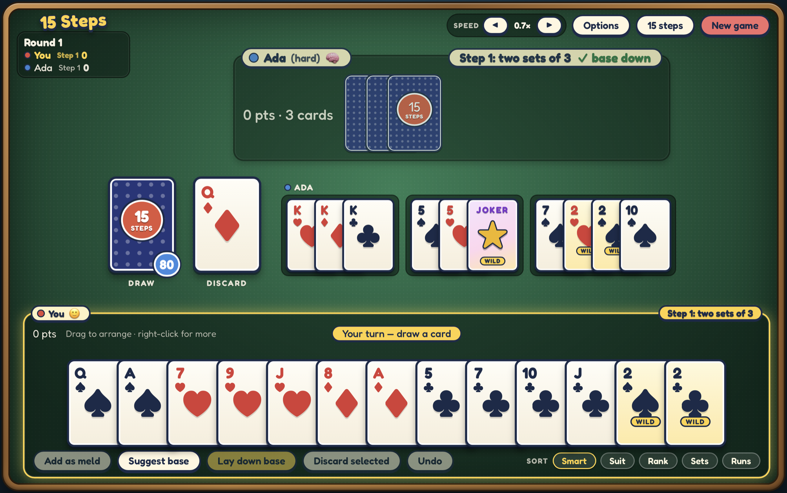

# 15 Steps

A digital version of the family card game **15 Steps**: a Liverpool-style rummy game for 2 to 6 players, played with two decks and jokers. Work through fifteen steps, each asking for a different combination of sets and runs, and finish with the lowest score.

Play against computer players (Easy, Medium or Hard), or sit back and watch the computers play each other.



## Download

Get the latest build from the [Releases page](../../releases/latest).

| Platform | File | Notes |
|----------|------|-------|
| **Mac** (Apple Silicon and Intel) | `15-Steps-<version>-mac-universal.dmg` | Open the disk image and drag **15 Steps** to Applications. |
| **Windows**, standalone | `15-Steps-<version>-windows-portable.exe` | One file. No install: download it and double-click. |
| **Windows**, installer | `15-Steps-<version>-windows-setup.exe` | Installs like a normal app, with a Start menu entry. |
| **Source** | `15-Steps-<version>-source.zip` | Or clone this repository. |
| **Android** | _planned_ | |

`SHA256SUMS.txt` on each release lists checksums for the files.

### First launch: unsigned app warnings

The apps are not code-signed yet, so your computer will warn you the first time.

- **Mac:** right-click the app and choose **Open** (once), or go to System Settings → Privacy & Security → **Open Anyway**.
- **Windows:** SmartScreen says "Windows protected your PC". Click **More info**, then **Run anyway**.

Windows needs the WebView2 runtime, which is already part of Windows 10 and 11.

## How to play

The full rules are in [RULES.md](RULES.md). In short:

- 13 cards each, from two decks plus four jokers (108 cards). **Jokers and 2s are wild.**
- On your turn, **draw** a card (from the stock or the top of the discard pile), **lay down** melds if you can, then **discard** one card.
- Each step has a **base** to lay down before any other meld. After that, you can add more sets and runs and **build on** anyone's melds.
- Go out by getting rid of every card, including your last discard. Everyone else scores penalty points for the cards in their hand.
- If you laid your base this round you move to the next step; if not, you repeat it. Lowest score wins once someone goes out on Step 15.

| Step | Base | Step | Base |
|-----:|------|-----:|------|
| 1 | Two sets of 3 | 9 | Two runs of 3 and a set of 3 |
| 2 | A set of 3 and a run of 3 | 10 | Two sets of 4 |
| 3 | A run of 7 | 11 | A set of 3 and a run of 5 |
| 4 | Five pairs | 12 | A set of 3 and a run of 7 |
| 5 | Three sets of 3 | 13 | A set of 7 |
| 6 | Two sets of 3 and a run of 3 | 14 | A set of 5 and a run of 3 |
| 7 | A set of 4 and a run of 3 | 15 | A run of 10 |
| 8 | Two runs of 4 | | |

### Using the app

- **Drag** cards to arrange your hand; **right-click** a card for more options.
- **Suggest base** looks through your hand and finds a way to lay down the current step's base.
- **Undo** takes back laying a meld or building (but not drawing a card, so you can't peek at the stock).
- **Speed** sets how quickly the computers play. **Options** has sound, music and animation settings, and your game is saved automatically, so you can close the app and carry on later.

## Where the game comes from

15 Steps is a family variant of the **contract rummy** family (also known as Liverpool rummy, Shanghai rummy and other names), where each round has a different contract. The usual versions have about seven rounds; this one has fifteen. We haven't found it written down under the name "15 Steps", so if you know where your family learned it, we'd love to hear.

## Building from source

You need [Node.js](https://nodejs.org) 24 or newer.

```
npm install
npm run dev            # the game in your browser, with hot reload
npm test               # all tests
npm run typecheck      # TypeScript check (tests don't type-check)
npm run build          # production web build to dist/
npm run sim -- 100     # 100 computer-vs-computer games, with win rates per difficulty
```

To build the desktop app yourself you also need [Rust](https://rustup.rs) and the [Tauri prerequisites](https://tauri.app/start/prerequisites/) for your system, then:

```
npm run tauri build
```

### How it is put together

- `src/engine/`: the rules, as a pure, deterministic state machine. A game can be replayed exactly from its seed and actions.
- `src/ai/` and `src/sim/`: the computer players and a runner that plays any mix of players to the end.
- `src/ui/`: the React interface. All logic lives in `controller.ts` so it can be unit tested.
- `src-tauri/`: the [Tauri](https://tauri.app) shell that wraps the game in a native window.

See [DESIGN.md](DESIGN.md) for the design decisions, the visual design system and the roadmap, and [RELEASING.md](RELEASING.md) for how a release is made. Pushing a tag such as `v1.0.0` builds everything and creates a draft release.

## Roadmap

- Linux and Android versions
- Deck and table themes
- Online multiplayer

## License

[MIT](LICENSE): free to use, copy, change and share, including in your own projects, as long as the copyright notice stays with it.

The bundled [Fredoka](https://github.com/hafontia/Fredoka-One) font is under the SIL Open Font License 1.1.
